<picture>
  <source media="(prefers-color-scheme: dark)" srcset="assets/hero-dark.svg">
  
</picture>

  
  
  
  

 

<picture>
  <source media="(prefers-color-scheme: dark)" srcset="assets/about-dark.svg">
  
</picture>

  

<picture>
  <source media="(prefers-color-scheme: dark)" srcset="https://raw.githubusercontent.com/UserYahya/UserYahya/output/snake-dark.svg">
  
</picture>

<b>জ্ঞান উন্মুক্ত হোক</b> · let knowledge be free

